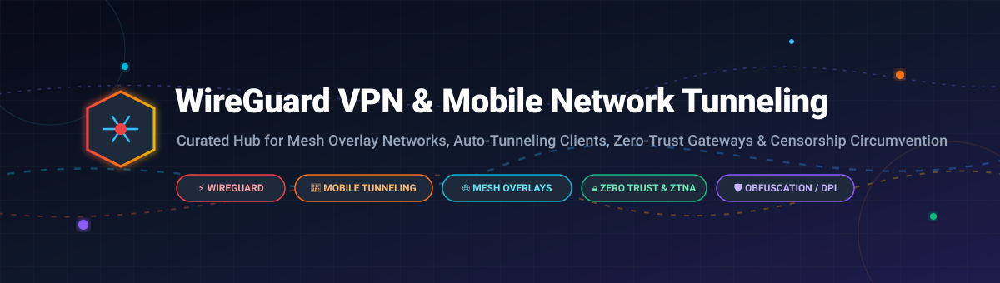

  

# 🛡️ Awesome WireGuard VPN & Mobile Network Tunneling 🚀

### A Curated Directory of Next-Generation Mesh Overlays, Mobile Roaming VPNs, Zero-Trust Gateways, and High-Performance Tunneling Solutions 🌐

  
  
  
  
  
  

  <b>🌟 Star this repository if you find it helpful! 🌟</b> 
  <i>Last updated: November 2026</i>

---

## 📖 Introduction & Technical Scope

Welcome to **Awesome-Wireguard-VPN-Mobile-Network-Tunneling** — the definitive curated directory tracking leading **SaaS platforms**, **mesh overlays**, and **open-source implementations** in modern network tunneling. 

Traditional VPN architectures relying on legacy IPsec and OpenVPN protocols introduce high latency, steep battery drain on mobile smartphones, and fragile connection reconnects during cellular-to-Wi-Fi network transitions. The **WireGuard®** protocol fundamentally transforms network tunneling through state-of-the-art cryptography (ChaCha20, Poly1305, Curve25519, BLAKE2s), minimal kernel overhead, lightweight connection state handshakes, and instant roaming recovery.

This repository catalogs top-tier tools across four essential pillars:
1. 📱 **Mobile Auto-Tunneling Clients**: Smart clients supporting SSID-triggered tunnel rules, multihop hops, battery-conserving kernel backends, and app-level split tunneling across Android and iOS.
2. 🕸️ **Peer-to-Peer Mesh Overlay Networks**: Identity-centric zero-config peer routing leveraging WireGuard tunnels, STUN/TURN/WebRTC NAT traversal, MagicDNS, and dynamic key distribution.
3. 🔒 **Enterprise Zero-Trust Network Access (ZTNA)**: Modern software-defined perimeters replacing perimeter firewalls with least-privilege access rules, SAML/OIDC SSO, and WebAuthn MFA.
4. 🛡️ **Anti-Censorship & Obfuscation Transports**: Post-quantum key exchange extensions (Rosenpass) and DPI-evasion wrappers (AmneziaWG, wstunnel, udp2raw) that disguise UDP tunnel traffic across hostile networks.

---

## 📑 Table of Contents

- [📊 Sector Overview & Market Dynamics](#-sector-overview--market-dynamics)
- [☁️ SaaS & Hosted Platforms](#️-saas--hosted-platforms)
- [💻 Open-Source GitHub Projects](#-open-source-github-projects)
- [⭐ Star History](#-star-history)
- [🤝 How to Contribute](#-how-to-contribute)
- [💖 Support](#-support)
- [⚖️ Disclaimer](#️-disclaimer)

---

## 📊 Sector Overview & Market Dynamics

The global Virtual Private Network (VPN) and Zero-Trust Network Access (ZTNA) market is estimated at **$54.5 billion to $62.8 billion in 2026** and projected to exceed **$120 billion by 2031**, progressing at a Compound Annual Growth Rate (**CAGR of ~16.2%**). The industry is undergoing a structural paradigm shift from legacy monolithic IPsec/OpenVPN architectures toward lightweight, cryptographically lean tunneling engines (principally WireGuard and MASQUE).

In terms of competitive landscape, the sector is **moderately fragmented with strong consolidation trends** at the high end:
- The **enterprise mesh and corporate zero-trust remote access** tier exhibits high concentration around a handful of dominant leaders (Cloudflare, Tailscale, Twingate, and enterprise security platforms) driven by sticky enterprise identity integrations and global edge point-of-presence (PoP) network moats.
- Conversely, the **consumer privacy and mobile auto-tunneling** segment remains moderately fragmented across specialized privacy providers (Mullvad, Proton VPN, Nord Security, Kape Technologies) alongside a vibrant, rapidly innovating grassroots open-source ecosystem (Headscale, NetBird, Netmaker, WG Tunnel) providing self-hosted protocol freedom and censorship circumvention.

---

## ☁️ SaaS & Hosted Platforms

The following table benchmarks notable SaaS platforms, commercial privacy VPNs, and cloud mesh network orchestrators powered by WireGuard and modern tunneling technologies. The table is ranked in **descending order by company scale** (estimated valuation or annual revenue run-rate):

| Provider / Platform | Valuation / Company Scale 📈 | Starting Tier Pricing 💰 | Free Tier / Free Trial Limits 🎁 | Protocol & Core Mobile Capabilities ⚡ |
| :--- | :--- | :--- | :--- | :--- |
| **[Cloudflare WARP & Zero Trust](https://one.one)** | ~$35 Billion Market Cap (Public: NYSE: NET) | $7.00 per user / month (Zero Trust Standard) | Free plan forever for up to 50 users (includes 3 network locations & WARP client routing) | Powered by BoringTun Rust WireGuard implementation and MASQUE HTTP/3 tunnels; instant cellular/Wi-Fi handoff. |
| **[NordVPN (NordLynx)](https://nordvpn.com)** | ~$3.0 Billion Valuation (Nord Security) | $3.09 per month (billed $83.43 for first 2 years) | 30-day money-back guarantee (unlimited bandwidth on 10 devices during trial period) | Proprietary NordLynx double-NAT WireGuard implementation; seamless mobile cellular auto-connect and meshnet features. |
| **[Surfshark](https://surfshark.com)** | ~$3.0 Billion Valuation (Part of Nord Security Group) | $1.99 per month (billed $53.73 for first 27 months) | 7-day free trial on Android & iOS mobile apps; 30-day money-back guarantee | Native WireGuard tunneling, GPS spoofing overrides for Android, dynamic MultiHop routing, and unlimited simultaneous devices. |
| **[ExpressVPN](https://expressvpn.com)** | ~$1.5 Billion (Acquired by Kape Technologies for $936M) | $8.32 per month (billed $99.95 for first 12 months) | 7-day free trial on mobile (iOS/Android app stores); 30-day money-back guarantee | Proprietary Lightway protocol alongside WireGuard interoperability, mobile Network Lock kill switch, and split tunneling. |
| **[Tailscale](https://tailscale.com)** | ~$1.2 Billion Valuation (Series B) | $6.00 per active user / month (Personal Plus plan) | Free plan forever for up to 3 users and 100 connected devices (includes 3 subnet routers & MagicDNS) | Zero-configuration WireGuard mesh overlay; automatic NAT traversal, MagicDNS, SSO authentication, and mobile battery optimization. |
| **[Twingate](https://twingate.com)** | ~$400 Million Valuation (Series B) | $5.00 per user / month (billed annually, Teams tier) | Free plan forever for up to 5 users and 1 remote network (includes 2 connectors & mobile split tunneling) | Zero-Trust Network Access (ZTNA) platform replacing legacy VPN concentrators with identity-driven split-tunnel mobile routing. |
| **[Proton VPN](https://protonvpn.com)** | ~$350 Million Valuation (Proton AG) | €4.49 per month (billed €107.76 for 2-year plan) | Free plan forever with 1 device, unlimited bandwidth, medium speed across servers in 5 countries | Swiss-based privacy VPN with 100% open-source mobile clients, WireGuard protocol acceleration, NetShield ad blocking, and Kill Switch. |
| **[ZeroTier](https://zerotier.com)** | ~$80 Million Valuation | $5.00 per member / month (billed annually, Professional tier) | Free plan forever for up to 25 connected network nodes (includes 1 admin seat & unlimited virtual networks) | Peer-to-peer virtual Ethernet mesh network connecting mobile nodes, cloud instances, and edge devices across restrictive NATs. |
| **[Windscribe](https://windscribe.com)** | ~$50 Million Revenue | $5.75 per month (billed $69.00 annually) or $3.00/mo Build-A-Plan | Free plan forever with 10 GB bandwidth per month across 10 global server locations (with verified email) | Custom WireGuard config generator, R.O.B.E.R.T. server-side ad/malware blocking, and mobile stealth obfuscation protocol wrappers. |
| **[Mullvad VPN](https://mullvad.net)** | ~$35 Million Revenue (Amagicom AB) | €5.00 flat per month (~$5.45/mo flat pricing) | No free tier; strict 30-day money-back guarantee (refundable even with cryptocurrency or cash payments) | High-integrity privacy service; anonymous number accounts, native WireGuard multi-hop routing, and DAITA traffic-analysis resistance. |
| **[IVPN](https://ivpn.net)** | ~$15 Million Revenue | $6.00 per month (Standard tier for 2 devices) | 30-day money-back guarantee (full unrestricted access during guarantee period across mobile/desktop) | Audited open-source client apps, native WireGuard key rotation intervals, Multi-Hop tunnels, and anti-tracker DNS filtering. |

---

## 💻 Open-Source GitHub Projects

A comprehensive collection of open-source WireGuard engines, auto-tunneling mobile clients, post-quantum extensions, self-hosted controllers, and anti-censorship wrappers. The table is strictly sorted in **descending order by GitHub stargazers count** ⭐:

| Project & Repository | GitHub_Stars 🌟 | Primary Category / Focus | Description & Architectural Highlights |
| :--- | :---: | :--- | :--- |
| **[juanfont/headscale](https://github.com/juanfont/headscale)** |  | Self-Hosted Mesh Controller | Open-source, self-hosted implementation of the Tailscale coordination server enabling full privacy and complete infrastructure control with official Tailscale mobile clients. |
| **[tailscale/tailscale](https://github.com/tailscale/tailscale)** |  | Mesh VPN Client & Engine | The official open-source Tailscale client node, WireGuard userspace engine, MagicDNS client, and cross-platform mobile/desktop CLI tools. |
| **[netbirdio/netbird](https://github.com/netbirdio/netbird)** |  | Zero-Trust Mesh Platform | Open-source zero-trust peer-to-peer overlay network combining WireGuard kernel/userspace encryption with WebRTC ICE NAT traversal and SSO authentication. |
| **[trailofbits/algo](https://github.com/trailofbits/algo)** |  | Hardened VPN Deployment | Automated Ansible deployment scripts by Trail of Bits to spin up hardened, disposable WireGuard servers on major cloud providers with native mobile profiles. |
| **[openwrt/openwrt](https://github.com/openwrt/openwrt)** |  | Router Firmware & Gateway | Embedded Linux operating system for home and travel routers, providing native kernel-space WireGuard tunneling, policy routing, and mobile hotspot gateways. |
| **[wg-easy/wg-easy](https://github.com/wg-easy/wg-easy)** |  | Docker Server & Web GUI | The easiest all-in-one Docker image for WireGuard featuring an integrated web administration interface, bandwidth metering, and instant mobile QR code provisioning. |
| **[StreisandEffect/streisand](https://github.com/StreisandEffect/streisand)** |  | Multi-Protocol Tunnel Server | Automated setup of WireGuard, Shadowsocks, and anti-censorship protocols with instruction profiles custom-tailored for mobile clients. |
| **[slackhq/nebula](https://github.com/slackhq/nebula)** |  | Overlay Mesh Network | Scalable mutual-discovery overlay network engineered by Slack using Noise Protocol cryptography, dynamic discovery lighthouses, and mobile client apps. |
| **[amnezia-vpn/amnezia-client](https://github.com/amnezia-vpn/amnezia-client)** |  | Anti-Censorship Client | Multi-protocol open-source client for mobile and desktop supporting WireGuard, AmneziaWG obfuscated protocol, Xray, and Shadowsocks. |
| **[rathole-org/rathole](https://github.com/rathole-org/rathole)** |  | NAT Traversal Proxy | High-performance reverse proxy written in Rust for NAT traversal, exposing internal WireGuard endpoints behind restrictive CGNAT environments. |
| **[gravitl/netmaker](https://github.com/gravitl/netmaker)** |  | Overlay Mesh Orchestrator | Fast WireGuard automation platform for creating flat mesh networks, site-to-site tunnels, Kubernetes interconnects, and remote mobile access gateways. |
| **[angristan/wireguard-install](https://github.com/angristan/wireguard-install)** |  | Server Install Script | Shell script for rapid, automated WireGuard server installation, secure peer key generation, iptables routing, and terminal QR code mobile exports. |
| **[firezone/firezone](https://github.com/firezone/firezone)** |  | ZTNA & Remote Access | Fast zero-trust access platform built on WireGuard with granular role-based resource permissions, Google/Okta SSO, and native Android/iOS apps. |
| **[wangyu-/udp2raw](https://github.com/wangyu-/udp2raw)** |  | UDP Packet Obfuscator | Tunnel utility converting WireGuard UDP packets into encrypted FakeTCP, ICMP, or UDP frames to bypass severe ISP UDP throttling and firewalls. |
| **[bepass-org/oblivion-desktop](https://github.com/bepass-org/oblivion-desktop)** |  | Censorship Circumvention | Anti-censorship and privacy tunnel integrating WireGuard and Cloudflare WARP with noise injection and endpoint spoofing for mobile and desktop. |
| **[pivpn/pivpn](https://github.com/pivpn/pivpn)** |  | Home Server Installer | The gold-standard WireGuard installer and peer management CLI tailored for Raspberry Pi, Debian, and Ubuntu home network gateways. |
| **[mullvad/mullvadvpn-app](https://github.com/mullvad/mullvadvpn-app)** |  | Privacy Mobile Client | Official open-source desktop and mobile client application for Mullvad VPN with WireGuard multihop, DNS content blocking, and DAITA anti-tracking defense. |
| **[cloudflare/boringtun](https://github.com/cloudflare/boringtun)** |  | Userspace Protocol Engine | High-performance userspace implementation of the WireGuard protocol written in Rust, powering Cloudflare WARP and edge network devices. |
| **[erebe/wstunnel](https://github.com/erebe/wstunnel)** |  | WebSocket Tunnel Proxy | High-speed tunneling tool that wraps WireGuard UDP traffic inside WebSocket, TLS, or HTTP/2 streams to bypass corporate proxies and firewalls. |
| **[tonarino/innernet](https://github.com/tonarino/innernet)** |  | CIDR-Based Overlay | Private overlay network built in Rust on top of WireGuard, utilizing IP CIDR-based access control trees and lightweight peer discovery. |
| **[WireGuard/wireguard-go](https://github.com/WireGuard/wireguard-go)** |  | Go Protocol Core | Official Go userspace implementation of the WireGuard protocol for mobile devices, embedded systems, and platforms lacking kernel modules. |
| **[ProtonVPN/android-app](https://github.com/ProtonVPN/android-app)** |  | Mobile Android App | Official open-source Proton VPN Android application featuring WireGuard protocol acceleration, NetShield DNS filtering, and system kill switch. |
| **[wgtunnel/android](https://github.com/wgtunnel/android)** |  | Mobile Auto-Tunnel Client | Feature-rich open-source Android client with automatic Wi-Fi/cellular rule switching, AmneziaWG obfuscation, multihop, and local SOCKS5 proxy. |
| **[DefGuard/defguard](https://github.com/DefGuard/defguard)** |  | Enterprise ZTNA VPN | Open-source enterprise zero-trust WireGuard VPN platform with WebAuthn/YubiKey MFA, automated multi-factor enrollment, and native mobile clients. |
| **[amnezia-vpn/amneziawg-go](https://github.com/amnezia-vpn/amneziawg-go)** |  | DPI-Resistant Protocol Core | Userspace Go implementation of the AmneziaWG protocol introducing junk packet injection, header randomization, and DPI circumvention. |
| **[bepass-org/wireguard-go](https://github.com/bepass-org/wireguard-go)** |  | Obfuscated Go Engine | Forked userspace WireGuard implementation optimized for censorship circumvention, mobile stability, and advanced traffic obfuscation. |
| **[h44z/wg-portal](https://github.com/h44z/wg-portal)** |  | Web Management Portal | Self-hosted web management portal and API for WireGuard with LDAP/OIDC authentication, QR code mobile config distribution, and IPAM. |
| **[complexorganizations/wireguard-manager](https://github.com/complexorganizations/wireguard-manager)** |  | Server Management Script | Automated bash script for configuring, hardening, and maintaining multi-user WireGuard servers with terminal mobile QR code profiles. |
| **[subspacecommunity/subspace](https://github.com/subspacecommunity/subspace)** |  | Web Server GUI | Simple web-based management GUI for WireGuard VPN servers enabling fast onboarding and QR code distribution for mobile users. |
| **[WireGuard/wireguard-android](https://github.com/WireGuard/wireguard-android)** |  | Official Android Client | Official open-source Android client application for WireGuard supporting kernel module execution, quick settings tiles, and battery savings. |
| **[rosenpass/rosenpass](https://github.com/rosenpass/rosenpass)** |  | Post-Quantum Cryptography | Post-quantum secure key exchange protocol in Rust that injects quantum-resistant preshared keys into active WireGuard sessions. |
| **[WireGuard/wireguard-apple](https://github.com/WireGuard/wireguard-apple)** |  | Official Apple Client | Official Apple ecosystem client for WireGuard supporting iOS, iPadOS, and macOS with on-demand cellular and Wi-Fi auto-tunneling. |
| **[omniedgeio/omniedge](https://github.com/omniedgeio/omniedge)** |  | Peer-to-Peer Mesh VPN | Open-source peer-to-peer overlay network connecting mobile devices, laptops, and edge hardware into a zero-configuration virtual LAN. |

---

## 📈 Star History

##  Star History
#`

---

## 🤝 How to Contribute

Contributions are wholeheartedly welcome! To propose additions, updates, or fixes:

1. **Fork the Repository** on GitHub.
2. **Create a Feature Branch** (`git checkout -b feature/new-wireguard-tool`).
3. **Add or Edit Entries** in [README.md](file:///C:/Users/hp/Documents/Projects/Awesome-Wireguard-VPN-Mobile-Network-Tunneling/README.md).
   - Ensure the entry includes the official repository/website URL, accurate pricing/stargazer stats, and an objective technical summary.
   - For SaaS products, verify pricing tiers and explicit free limits.
   - For open-source tools, include the proper stargazers badge linking to the repository's stargazers tab.
4. **Commit Your Changes** (`git commit -m 'Add Amazing-WireGuard-Tool'`).
5. **Open a Pull Request** with a concise description of why the tool should be included.

---

## 💖 Support

If this curated collection of WireGuard, mesh networking, and mobile tunneling projects has saved you time or aided your network architecture decisions, please consider supporting the project:

- ⭐ **Star this repository** to improve visibility for the developer community.
- 🍴 **Fork and share** the project with fellow network engineers, sysadmins, and privacy advocates.
- ☕ **Buy me a coffee / Sponsor on GitHub**: Show your support directly via the [GitHub Sponsors Dashboard](https://github.com/sponsors/ishandutta2007). Every bit of support is deeply appreciated and fuels continuous maintenance!

---

## ⚖️ Disclaimer

*This curated repository is maintained for educational, technical, and architectural research purposes. Product names, logos, and brands are property of their respective owners. Mention of commercial products or open-source projects does not constitute legal or security endorsement.*
